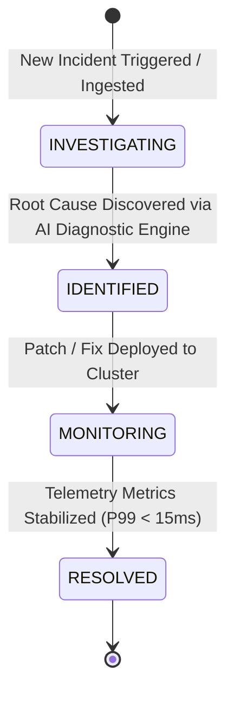
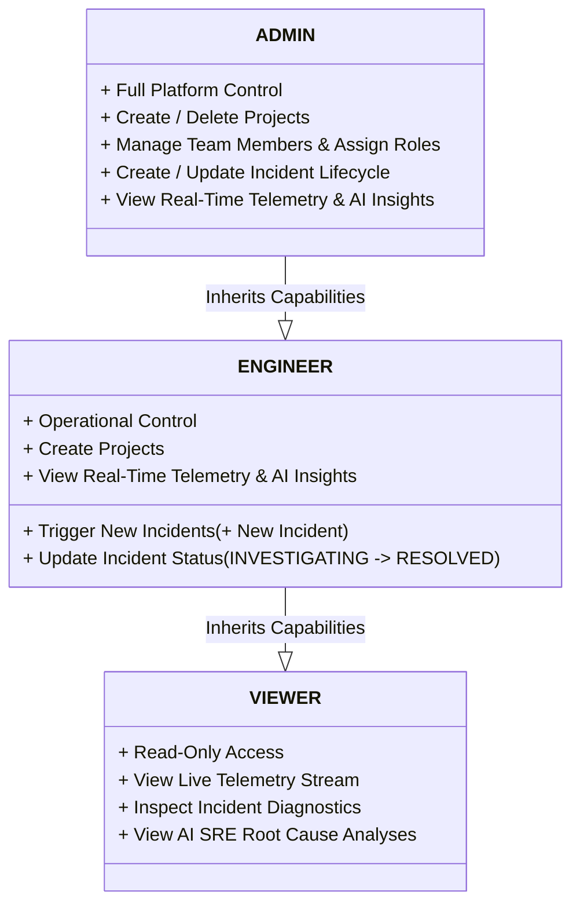

# UpNode — Next-Gen Telemetry & Incident Intelligence Platform

<p align="center">
  
  
  
  
  
  
</p>

**UpNode** is a high-performance, real-time observability and site reliability engineering (SRE) platform designed for modern microservice architectures. It provides real-time Server-Sent Events (SSE) telemetry streaming, interactive drag-and-drop diagnostic workspaces, AI-driven incident root cause analysis, and granular Role-Based Access Control (RBAC).

---

## 📐 System Architecture

The following Mermaid diagram outlines the end-to-end architecture of UpNode, showing data flow between the Next.js client, Express backend, Prisma ORM database layer, and real-time SSE event bus.

```mermaid
graph TD
    subgraph Client ["Client Layer (Next.js 16 App Router)"]
        UI["Landing & Telemetry Dashboard"]
        SSE_Client["useIncidentStream (EventSource Reader)"]
        DND["Drag & Drop Diagnostic Workspace"]
        RBAC_UI["Team & Role Management (RBAC)"]
    end

    subgraph Backend ["Server Layer (Express & TypeScript)"]
        API["REST API Router (/api/v1)"]
        SSE_Hub["SSE Event Stream Hub"]
        Auth_Mid["JWT Auth & RBAC Middleware"]
        AI_Service["AI SRE Diagnostic Engine"]
    end

    subgraph Database ["Persistence Layer"]
        Prisma["Prisma ORM"]
        DB[(PostgreSQL / Database)]
    end

    UI -->|HTTP / REST Requests| API
    SSE_Client <==|Server-Sent Events (SSE) Live Stream| SSE_Hub
    API --> Auth_Mid
    Auth_Mid -->|Validate Permissions| API
    API -->|Read/Write Operations| Prisma
    API -->|Generate Root Cause Analysis| AI_Service
    Prisma --> DB
    API -->|Broadcast New Incidents/Updates| SSE_Hub
```

---

## 🔄 Telemetry Incident Lifecycle & Workflow

UpNode provides an automated incident lifecycle with live status synchronization across all connected team members.



---

## 🔐 Role-Based Access Control (RBAC) Matrix

UpNode implements zero-trust IAM roles (`ADMIN`, `ENGINEER`, `VIEWER`) enforced at both backend API middleware and frontend UI levels.



---

## ✨ Key Features

- **⚡ Real-Time SSE Telemetry Stream**: Zero-latency Server-Sent Events push incident updates live to all connected browser clients without polling overhead.
- **🖱️ Drag & Drop Diagnostic Workspace**: Drag incident cards from the telemetry stream directly into the diagnostic zone, or drop local `.log` / `.json` diagnostic files to parse instantly.
- **🤖 AI SRE Root Cause Engine**: Automated diagnostic insights that analyze system log traces, stack dumps, and metrics to recommend mitigation steps.
- **🔒 Granular Team RBAC**: Admin-controlled team management with instant role switching (`ADMIN`, `ENGINEER`, `VIEWER`) and portal-mounted confirmation dialogs.
- **🎨 Dynamic Theme Token System**: Seamless dark/light theme switching with unified CSS custom variables (`var(--lp-bg)`, `var(--lp-surface)`).
- **📱 Fully Responsive Dashboard**: Strict non-scrolling viewport frame (`h-screen overflow-hidden`) with dynamic zero-shift layout across mobile and desktop.

---

## 🛠️ Technology Stack

### Frontend (`/client`)
- **Framework**: Next.js 16 (App Router) & React 19
- **State & Data Fetching**: TanStack Query (React Query)
- **Styling & Aesthetics**: Tailwind CSS, Vanilla CSS Design System, Framer Motion
- **Icons**: Lucide React
- **Dates**: `date-fns`

### Backend (`/server`)
- **Runtime**: Node.js & Express with TypeScript
- **Database & ORM**: Prisma ORM with PostgreSQL / SQLite
- **Authentication**: JWT & Bcrypt password hashing
- **Real-Time Streaming**: Server-Sent Events (SSE) Response Streams
- **Validation**: Zod schema validation

---

## 📁 Repository Directory Structure

```
UpNode/
├── client/                     # Next.js Frontend Application
│   ├── src/
│   │   ├── app/                # App Router Pages (/, /dashboard, /dashboard/settings/team)
│   │   ├── components/         # Modular Components
│   │   │   ├── auth/           # Login, Register, Logout Confirm Modal
│   │   │   ├── dashboard/      # Header, Main Dashboard Container View
│   │   │   ├── incidents/       # Incident List, Incident Card, Details & Drag-and-Drop Workspace
│   │   │   ├── landing/        # Hero, Telemetry Preview, Features, Pricing
│   │   │   ├── projects/       # Projects Sidebar & Project Selectors
│   │   │   ├── team/           # Member List, Invite Modal, Remove Member Modal
│   │   │   └── ui/             # Status Dots, Theme Toggle, Glassmorphic Cards
│   │   ├── hooks/              # Custom React Hooks (useAuth, useIncidents, useIncidentStream)
│   │   └── services/           # Axios API Client & Endpoint Wrappers
│   └── package.json
│
└── server/                     # Express TypeScript Backend Application
    ├── src/
    │   ├── index.ts            # Server Entry Point & Express App Config
    │   ├── middlewares/        # JWT Auth Middleware & requireRole RBAC Guard
    │   ├── modules/            # Domain Modules
    │   │   ├── auth/           # Login & User Registration Routes
    │   │   ├── incidents/      # Incident CRUD Routes & Controllers
    │   │   ├── organization/   # Member Management & Invite Routes
    │   │   ├── projects/       # Project CRUD Routes
    │   │   └── stream/         # Server-Sent Events (SSE) Stream Controller
    │   └── services/           # AI Diagnostic Engine & Background Service
    ├── prisma/
    │   └── schema.prisma       # Database Models & Enums
    └── package.json
```

---

## 🚀 Getting Started & Local Development

### Prerequisites
- **Node.js**: `v18.x` or higher
- **npm**: `v9.x` or higher
- **Git**

---

### 1. Clone the Repository
```bash
git clone https://github.com/rashedulraha/UpNode-client.git
cd UpNode
```

---

### 2. Backend Setup (`/server`)

```bash
# Navigate to server directory
cd server

# Install dependencies
npm install

# Setup Environment Variables (.env)
cp .env.example .env

# Run Prisma Database Migrations
npx prisma db push

# Start Backend Development Server (Port 5000)
npm run dev
```

---

### 3. Frontend Setup (`/client`)

```bash
# Navigate to client directory (in a new terminal tab)
cd ../client

# Install dependencies
npm install

# Setup Environment Variables (.env.local)
cp .env.example .env.local

# Start Next.js Development Server (Port 3000)
npm run dev
```

Open **`http://localhost:3000`** in your browser to view the UpNode landing page and telemetry dashboard.

---

## 📡 API Endpoint Reference

| Method | Endpoint | Description | Required Role |
| :--- | :--- | :--- | :--- |
| `POST` | `/api/v1/auth/register` | Create a new user account & organization | Public |
| `POST` | `/api/v1/auth/login` | Authenticate user & receive JWT token | Public |
| `GET` | `/api/v1/stream/incidents` | SSE Stream endpoint for real-time incidents | Authenticated |
| `GET` | `/api/v1/incidents` | Fetch paginated telemetry incidents | `ADMIN`, `ENGINEER`, `VIEWER` |
| `POST` | `/api/v1/incidents` | Report a new telemetry incident | `ADMIN`, `ENGINEER` |
| `PATCH` | `/api/v1/incidents/:id/status` | Transition incident lifecycle status | `ADMIN`, `ENGINEER` |
| `GET` | `/api/v1/organization/members` | Fetch organization team members | `ADMIN`, `ENGINEER`, `VIEWER` |
| `POST` | `/api/v1/organization/invite` | Invite a new team member by email & role | `ADMIN` |
| `PATCH` | `/api/v1/organization/members/:id` | Update team member role (`ADMIN`, `ENGINEER`, `VIEWER`) | `ADMIN` |
| `DELETE` | `/api/v1/organization/members/:id` | Remove a team member from organization | `ADMIN` |

---

## 📜 License

Distributed under the **MIT License**. See `LICENSE` for details.

---

<p align="center">
  Built with precision by <strong>UpNode Engineering Team</strong>
</p>
